<p align="center">
<picture>
  <source media="(prefers-color-scheme: dark)" srcset="assets/readme/banner-dark.svg">
  
</picture>
</p>

<p align="center">
  <a href="docs/specs/2026-09-23-doorway-design.md"><b>Design spec</b></a> &nbsp;·&nbsp;
  <a href="docs/specs/2026-09-24-last-ten-metres-design.md"><b>The last 10 metres</b></a> &nbsp;·&nbsp;
  <a href="docs/CONTRACT.md"><b>Data contract</b></a> &nbsp;·&nbsp;
  <a href="docs/OPERATIONS.md"><b>Running it</b></a> &nbsp;·&nbsp;
  <a href="pitch/deck/Doorway-Praesentation.pdf"><b>Deck</b></a>
</p>

<p align="center">
  
  
  
  
  
  
</p>

**Doorway finds the specific door of a building you can actually use, and guides you to it.** A partially blind user follows Live View to a destination pin and arrives outside a building with no idea which of its doors works for him. Google Places can say that an accessible entrance *exists*; it can't say *where*. Doorway supplies the missing piece: the coordinates of the door, and guidance to it by arrow, audio beacon, speech and haptics.

Built at Google x Aktion Mensch, "AI Agents for Inclusion", Berlin, 23–24 September 2026, by Malek ([@Malek1414](https://github.com/Malek1414), data layer and backend) and Sami ([@sami-mag07](https://github.com/sami-mag07), delegated build agents for the UI).

<picture>
  <source media="(prefers-color-scheme: dark)" srcset="assets/readme/divider-dark.svg">
  
</picture>

## The gap, in numbers

- **Berlin Hauptbahnhof** has 109 entrance nodes in OpenStreetMap: 8 step-free, 11 not, 90 unknown. Maps shows one pin.
- Two of those doors are **9.1 m apart**. One is step-free, the other isn't, and the address (Invalidenstraße 52) belongs to the one that isn't. That is the door a geocoder resolves.
- Across **Berlin Mitte**, 3,061 entrances; only 296 say anything about step-free access.

## Who it's for

Designed on two independent axes instead of four disability categories, so a deafblind wheelchair user is handled without a fifth branch:

| Person | Step-free | Channels |
|---|---|---|
| Partially blind (the primary demo user) | no | large visuals + speech |
| Blind | no | speech + haptic |
| Deaf | no | visual + haptic |
| Wheelchair | **yes** | visual |
| Mute | no | any; no voice *input*, all controls stay tappable |

## How it works

```
BUILD TIME (committed to repo)
  overpass (tiled 4x4) -> entrances + buildings
  building association -> approach bearings
  places              -> tier 2 boolean + placeId
  gemini              -> one-sentence door descriptions
                       |
                 data/berlin-mitte.json      (see docs/CONTRACT.md)

RUNTIME
  static tiles (CDN)  ->  PWA  <-  backend proxy  ->  Gemini / Places
                           |
      GPS + compass -> geo core -> (bearing, distance, confidence)
                                    |-> AR overlay
                                    |-> audio beacon
                                    +-> speech
```

The audio beacon gets faster the more precisely you walk toward the door, so it works without looking; a long vibration means you've arrived.

### The confidence ladder

Every entrance carries a tier. **Only tier 1 may produce a directional arrow**; tiers 2 and 3 are text. This is a safety rule, not a style choice: a confident arrow to a door that isn't there can walk a blind user into traffic.

| tier | confidence | source | door coords? | arrow? |
|---|---|---|---|---|
| 1 | `surveyed` | OSM node + `wheelchair=yes` | exact | **yes** |
| 2 | `reported` | Places `accessibilityOptions`, Wheelmap | building only | no, points at the building |
| 3 | `community` | Gemini over reviews | none | **never** |
| 0 | `unknown` | nothing | none | no |

Revolving doors, steps and level mismatches come through as warnings. At Hauptbahnhof, Eingang Europaplatz is tagged step-free but is a revolving door, and Doorway says so.

### The last 10 metres

Navigation ends at a pin; Doorway's approach mode starts there and ends when you're through the door. The phone camera sends a frame to `/api/door-fix` (blind path: where is the door relative to the camera) or `/api/door-check` (wheelchair path: can I get through it). Both are allowed to answer "I can't see it", and the app then falls back to the surveyed OSM bearing and says which source is talking.

### Backend endpoints

`server/app.py` exists because a QR-distributed web app can't hold a Gemini or Places key. Keys stay in the server's environment.

| Endpoint | What it does |
|---|---|
| `GET /api/health` | which keys work and which Gemini models are live |
| `GET /api/live-url` | the current public address, for the iOS app |
| `GET /api/entrances` | entrance data (the app falls back to the static `data/berlin-mitte.json`) |
| `GET /api/lived/:placeId` | tier 3: verbatim review quotes about access, live only, never stored, `coords` always null |
| `POST /api/look` | one camera frame to one spoken sentence about where the door is |
| `POST /api/door-fix`, `POST /api/door-check` | the last-10-metres vision calls |
| `POST /api/route` | walking route via the Routes API; the web app computes it in the browser if no key works |
| `POST /api/speak` | runtime TTS for text with no pre-synthesised clip, cached |
| `POST /api/surface` | ground surface analysis from a walk video; the video is deleted as soon as analysis returns |

Model choices, with dates they were verified, are in `docs/CONTRACT.md`. Override them with `GEMINI_MODEL_LOOK`, `GEMINI_MODEL_LIVED`, `GEMINI_MODEL_TTS` and `GEMINI_TTS_VOICE`.

<picture>
  <source media="(prefers-color-scheme: dark)" srcset="assets/readme/divider-dark.svg">
  
</picture>

## Run it

### Keys

```bash
cp .env.example .env              # GEMINI_API_KEY, MAPS_API_KEY, optional ROUTES_API_KEY
cp web/config.example.js web/config.js   # mapsKey: a referrer-restricted Maps JavaScript key
```

`.env.example` explains which Maps Platform APIs each key needs. Gemini and Places keys never go in `web/config.js`; it's loaded at runtime and never bundled.

### Backend

```bash
ops/serve.sh                      # uvicorn server.app:app on :8090, loads .env itself
curl -s localhost:8090/api/health # "gemini" and "maps" must both be true
```

The server is FastAPI with `httpx` and `pydantic`, run by uvicorn; `serve.sh` uses `.venv/bin/python` if it exists. There's no requirements file. Without keys every route still answers 200 and quietly does the wrong thing, so check `/api/health` first (see `docs/OPERATIONS.md`).

### Web app

```bash
cd web
npm install
DOORWAY_API_PROXY=http://localhost:8090 npm run dev:https   # HTTPS on your LAN, so a phone gets GPS and compass
npm test                                                     # vitest
npm run build                                                # dist/, with data/berlin-mitte.json and config.js copied in
```

The dev server proxies `/api` to `DOORWAY_API_PROXY`, which defaults to `http://localhost:8080`. `?sim=1` replays a walk without leaving your desk. `web/e2e/` has Playwright-driven smoke and approach replays (`node e2e/smoke.mjs`, `node e2e/approach.mjs`).

### Demo ops

`ops/` keeps a demo up: `serve.sh` (backend), `tunnel.sh` (a fixed public host over serveo), `qr-watch.sh` (keeps a QR code pointing at the live URL) and `synth-when-quota.sh` (fills the audio bank when the TTS quota resets). All four are idempotent. `docs/OPERATIONS.md` lists the traps that cost a night.

### iOS

The iPhone app is a `WKWebView` over the public host, so web changes need no iOS rebuild.

```bash
cd ios && xcodegen generate       # the .xcodeproj is gitignored
```

Build and install steps are in `docs/OPERATIONS.md`.

### Data pipeline

```bash
python3 pipeline/ingest_osm.py                                      # tiled Overpass ingest for Berlin Mitte
python3 pipeline/enrich_bearings.py                                 # approach bearings from building geometry
GEMINI_API_KEY=... python3 pipeline/enrich_descriptions.py --limit 60   # one plain sentence per door
GEMINI_API_KEY=... python3 pipeline/synth_speech.py --lang de           # pre-synthesise spoken guidance
python3 pipeline/make_fixture.py --verify                           # re-derive the Hauptbahnhof fixture and diff
python3 pipeline/test_fixture.py                                    # does the data still agree with OSM?
```

If the 9.1 m pair at Hauptbahnhof ever breaks, the merge is wrong.

## Structure

```
data/        berlin-mitte.json (the contract) and pre-synthesised audio
pipeline/    OSM ingest, bearings, Gemini descriptions, TTS, fixtures and tests
server/      FastAPI proxy: app.py, approach.py, route.py, surface.py
web/         the PWA: src/core (geo, heading, beacon, speech, approach), src/ui, e2e/
ios/         WKWebView shell, generated with xcodegen
ops/         serve, tunnel, QR watcher, TTS top-up
docs/        CONTRACT, OPERATIONS, specs/, briefs/ for the build agents
pitch/       stage script (German), shot list, captions, consent, deck
brand/       the Doorway mark and app icons
questions.md the question channel between the two build agents
```

<p align="center">
  <br>
  <sub>Built by <a href="https://github.com/Malek1414">Malek Hassan</a> in Berlin.</sub>
</p>
